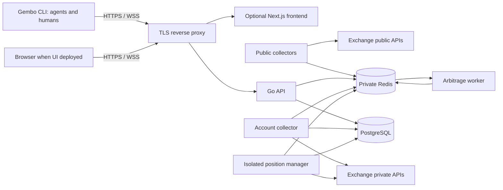

# Cloud and release operations

[Plan index](README.md)

## Recommended GCP path

Use a small **Compute Engine VM running prebuilt containers** for the initial monitoring deployment. Put a TLS reverse proxy in front of the API and optional frontend, keep Redis private, and use PostgreSQL through its existing interface. The installed `gembo` CLI accesses the authenticated API remotely; application operation must work without Next.js. This fits the current continuously running collectors and gives a straightforward, reserved outbound IP for exchange qualification.

The VM is a production application host, never an agent workstation or self-hosted CI runner. Agents execute on separate disposable infrastructure. Use Terraform for cloud resources and versioned deployment manifests for container configuration. Systemd can supervise the container stack and host boot sequence; deployment uses immutable images, not `git pull` followed by `go run`.

Start with a single qualified exchange and measure CPU, memory, subscription count, disk, and egress before sizing or adding all adapters. The existing development build configuration permits an 8 GB dependency build container; this is not a runtime requirement, but it reinforces the need to measure instead of assuming a micro VM will suffice.

### Deployment profiles

| Profile | Topology | Allowed use | Exit condition |
|---|---|---|---|
| Local/CI | Built CLI plus disposable Compose: backend, PostgreSQL, Redis, exchange simulator; frontend for UI tests | Deterministic tests; no production secrets | Repeatable clean bootstrap and headless CLI journey |
| Cloud pilot | One small GCE VM; private container Redis; local Postgres or optional Supabase Free; TLS; public-data collectors | Owner-only monitoring with synthetic account data; interruptions acceptable | Measured sizing, working deployment/rollback, monitoring, costed durable configuration |
| Durable production | Dedicated production GCP project; GCE application VM; Cloud SQL PostgreSQL; private Redis; retained artifacts/backups; separate staging | Public monitoring and approved private data | Restore drill, security/configuration gates, observed operation |
| Approved execution | Durable profile plus isolated execution workload identity/host, narrow keys, tested reconciliation and kill controls | Only the explicitly approved execution envelope | Continuous qualification; authority can be revoked independently of deployments |

Prefer moving durable data to the chosen production database **before** onboarding real credentials or execution history. If avoiding a database migration matters more than the pilot's hosting cost, choose Cloud SQL from the first cloud deployment. Supabase is optional, not a required waypoint.

A single application VM is deliberately a single point of failure. It can be appropriate for a supervised small deployment if the owner accepts recovery-based availability. It does not satisfy a high-availability promise. Before unattended execution, explicitly accept the tested recovery limits or add redundancy and fencing. Do not autoscale stateful executors simply because the infrastructure supports replicas.

### Managed compute alternatives

| Option | When to choose it | Consequences |
|---|---|---|
| Cloud Run frontend/API | Operational burden of the web host exceeds its simplicity; measured traffic favors managed scaling | Same images; explicit DB/Redis connectivity, routing, reconnect, and cold-start tests |
| Cloud Run worker pools | Managed continuous workers justify their steady cost and supported region/features | Configure instance count and ownership; instances are billed while idle |
| Cloud Run Jobs | Finite probes, migration jobs, scheduled reports, restore checks | Do not use a finite job as an indefinitely running collector |
| GKE | A demonstrated requirement for cluster scheduling, many services, or platform expertise | Defer; significantly more operational surface |

Cloud Run supports browser WebSockets, but requests still time out and clients must reconnect; open connections also incur active compute billing. Worker pools provide continuous compute and manual instance scaling, with requested instances billed while idle. Static outbound IP for Cloud Run requires additional networking configuration. These are viable alternatives, not assumptions of free hosting. [Cloud Run WebSockets](https://docs.cloud.google.com/run/docs/triggering/websockets), [worker-pool scaling](https://docs.cloud.google.com/run/docs/configuring/workerpools/manual-scaling), [static outbound IP](https://docs.cloud.google.com/run/docs/configuring/static-outbound-ip).

GCP's free VM offer is limited to selected US regions and resources. That may conflict with exchange access or the desired deployment region; it is not a suitable basis for assuming all collectors will run free. Supabase Free may pause for low activity and needs an explicit backup/export approach. Use it for disposable/pilot data, not as the unexamined recovery foundation for live execution. [GCP Free Tier](https://docs.cloud.google.com/free/docs/free-cloud-features), [Supabase production checklist](https://supabase.com/docs/guides/deployment/going-into-prod), [Supabase backups](https://supabase.com/docs/guides/platform/backups).

## Network and service layout

Publish a stable API base URL and WS route usable directly by the CLI, with a documented path-prefix contract. API routing must not require the Next.js rewrite server. When the UI is deployed, use same-origin browser routes where possible: `/` to Next.js, `/api/v1/*` to the API with deliberate prefix handling, and a documented WS route to the API. The proxy must support upgrade headers, suitable idle timeouts, and graceful connection draining. The frontend uses browser-relative routing or explicit runtime configuration; do not bake staging hostnames or secrets into promoted images. `NEXT_PUBLIC_*` values are public and may be compiled at build time, so resolve environment routing before claiming that one image is promoted unchanged.

Only HTTPS is public. Do not expose Redis, PostgreSQL, RedisInsight, pprof, Docker, metrics, or internal admin ports. Use private networking, firewall rules, and controlled administrative access such as IAP/OS Login. Cloud SQL uses a private connection or an authenticated connector and least-privilege database users. Validate Redis TLS/ACL support before adopting a managed Redis service; the current client configuration needs explicit qualification.

Reserve stable egress for private exchange credentials and maintain allowlists. Verify each exchange/product from that exact region and IP. Restrict secret-bearing workloads to needed destinations; an unrestricted network plus a key is a data-exfiltration path even when the key is read-only. For VMs, enforce workload access to metadata and service-account credentials; do not give every container the host's broad cloud identity.

Public collectors get no exchange account secrets. The account collector uses read-only credentials when available. The execution workload receives only approved execution keys. Keep frontend, build, agent, and monitoring identities unable to read those keys. If existing interfaces require a private adapter with write methods for read collection, enforce permissions at the credential and workload boundary as well as in code.

For the initial owner-only deployment, retain application authentication even if an additional access proxy is used. Before broader access, qualify rate limiting, login abuse controls, session revocation, origin/CSRF rules, request limits, and authorization on every state-changing API.

Any access proxy must support approved noninteractive identities, not force a browser login for agents. Public API reachability is not public authorization. Test the actual installed CLI through production TLS, routing, and auth. Supply safe endpoint profiles independently of binary packaging; profile selection never grants permissions.

## Environment boundaries

| Environment | Data and credentials | Lifecycle |
|---|---|---|
| PR validation | Synthetic data; no cloud or exchange secrets | Disposable per run |
| Preview | Optional synthetic web preview; no private collector/executor | Trusted changes only; deleted when PR closes or TTL expires |
| Staging | Separate Redis/Postgres; synthetic users; optional dedicated sandbox keys | Mirrors release topology and schema; can be scheduled off when unused |
| Production | Dedicated database, secret versions, network, and identities | Protected deployment and retention policies |
| Agent control | Separate identities and, when persistent, separate GCP project/state | Cannot connect to production stores by default |

Use separate GCP projects for staging and production once durable cloud operation starts. Separate Terraform state, backend access, service accounts, budget alerts, database users, and encryption-key access. A Redis DB number or naming prefix alone is not environment isolation. Staging may use smaller resources, but must retain production protocols and failure behavior.

An economical staging environment may be ephemeral: create it from the same definitions, restore only synthetic fixtures, qualify the release, retain results, and destroy it. Private exchange accounts and quotas remain separately scoped. Do not duplicate Supabase projects for every PR; local disposable databases are sufficient.

## Build and CI pipeline

Create future workflows for `ci`, `exchange-contracts`, `release`, `deploy`, `agent-task`, and `maintenance`. Names are proposals; functionality and privilege boundaries matter more than filenames.

1. **Pull request:** run deterministic checks without production secrets. Detect changed areas, but always emit a final required `verify` result. Path filters must not leave required checks permanently pending or skip relevant shared contracts.
2. **Review:** record risk class, independent review, test evidence, and operational changes. Protect workflow, policy, infrastructure, auth, migrations, credential, and execution changes with explicit owner review.
3. **Protected main:** rerun required checks on the actual merged revision. Build affected OCI images and CLI binaries once, scan them, generate SBOM/provenance, publish image digests to Artifact Registry and verified CLI archives through the selected release channel. Reuse unaffected artifacts if compatibility is verified. Include supported-OS install smoke and client/server version-skew tests.
4. **Staging:** deploy the exact candidate digests, install the candidate CLI, run controlled migrations, CLI/API/WS smoke and applicable exchange probes, and observe resources/freshness. Run browser smoke when the release includes the UI.
5. **Release dossier:** generate a compact report with change summary, affected services/CLI, risk, checks, complete CLI capability coverage, live exchange status, schema/config changes, client compatibility, rollback plan, and estimated cost change.
6. **Production:** approved workflow promotes those same digests and compatible configuration. It never rebuilds code or trusts a mutable `latest` tag.
7. **Verification:** validate deployment/CLI identity, readiness, real data flow, and a synthetic noninteractive CLI journey; also validate exposed UI journeys. Observe for the specified interval and roll back or halt according to policy.

Initially every production deployment requires owner approval. After confidence is earned, allow automatic deployment only for explicitly classified low-risk changes. Staging deployment can be automatic earlier. Keep auto-merge and auto-deploy as separate policy choices.

GitHub environments can hold deployments for review. Self-review prevention can deadlock a sole operator who triggered the workflow, so choose the approval arrangement deliberately rather than blindly enabling every switch. Configure branch restrictions and bypass behavior, and test an actual denied deployment. Feature availability depends on repository visibility and plan. [GitHub deployment environments](https://docs.github.com/en/actions/reference/workflows-and-actions/deployments-and-environments).

Use GCP Workload Identity Federation for GitHub deployment jobs instead of stored service-account JSON keys. Restrict trust by numeric repository/owner identity, approved workflow/ref/environment, and a narrow service account. Permit image publishing, staging deployment, production deployment, and infrastructure application through distinct identities. [GCP deployment federation](https://docs.cloud.google.com/iam/docs/workload-identity-federation-with-deployment-pipelines).

Build jobs execute repository code without deployment credentials. Publishing and deployment jobs consume validated artifacts and execute trusted tooling. Avoid placing cloud credentials in the same shell environment as dependency installation, arbitrary tests, or agent-generated scripts.

## Release manifest and migration policy

Each immutable release manifest records:

- Release ID, source commit, component image digests, toolchain/lock hashes, and provenance references.
- CLI artifact digests/platforms, machine protocol version, supported client/server ranges, capability coverage report, and migration/deprecation notes.
- Configuration schema/version and secret **version identifiers**, never secret values.
- Database schema before/after, minimum supported application schema, Redis key/message compatibility, and migration checksum.
- CI and live-probe run IDs, staging results, known exceptions with expiry, approving actor, and approval time.
- Previous compatible release, rollout sequence, stop conditions, and rollback procedure.

Run production migrations once as an explicit job with DDL permission and a lock. Runtime application users do not need schema modification permissions. Test a clean database and upgrade from the prior production schema with representative data. Migrations must respect lock/statement timeouts and resource budgets.

Prefer expand-and-contract: add compatible schema first, deploy code that works during transition, backfill in bounded resumable batches, then remove obsolete structure in a later reviewed release. Test both the new application and the designated rollback application against the expanded schema. A `.down.sql` file is not proof that rollback preserves data.

Redis key/message changes also need compatibility or a deliberate cache-rebuild plan. Do not flush shared data during rollout. Current Redis Pub/Sub notifications are not a durable command queue: execution intent must be recoverable from durable records, with idempotent processing and reconciliation. Verify the existing recovery logic before deciding whether it needs an outbox or other durable dispatch mechanism.

PostgreSQL contains identity, credential, and execution state and is authoritative. Redis can be treated as reconstructable only after every use—including enabled hooks—is classified. If a hook/queue becomes authoritative, give it durable delivery and test crash recovery rather than assuming Pub/Sub or list writes provide it.

## Rollout, rollback, and execution control

Use one serialized deployment per environment; do not cancel a migration or partially applied deployment because a newer commit arrives. Queue or supersede only at a safe pre-deploy boundary.

On the pilot VM, keep the prior manifest and image digests. For stateless services, start the new version, pass readiness, switch the proxy, and drain the old version where resources permit. If memory cannot support overlap, use a documented brief maintenance window. Never promise zero downtime without testing the actual capacity.

Keep the previous supported CLI artifacts and test their compatibility with both candidate and rollback servers. A server rollback does not roll back already-installed clients. Pin agent CLI digests per run, never self-update mid-task, and refuse incompatible writes before dispatch. Follow the [CLI distribution/compatibility contract](06-cli-contract.md).

Collectors and execution processes need explicit ownership. A nominal replica count of one does not prevent old and new instances from overlapping during deployment. Use per-exchange/account leases with fencing or a verified stop-before-start policy plus reconciliation. Before starting the new executor, prove the old instance cannot continue issuing commands. A DB lease must be checked at the side-effect boundary; a stale worker must stop on lease loss.

An exchange may not understand your fencing token. A database lease alone therefore cannot guarantee that a paused old process will never issue an external request. Combine platform-level stop/termination verification, exchange-supported idempotency identifiers where available, and reconciliation; block execution when ownership remains uncertain. Do not claim exactly-once external execution from an internal lock.

Rollback triggers include failed readiness, elevated application errors, missing WS delivery, material freshness regression, and repeated startup crashes. Initially use a 15-minute post-deploy observation window and a longer staging soak for exchange/execution changes. Treat these as tunable defaults. Do not roll back repeatedly for an unrelated provider outage.

An application rollback cannot reverse an external exchange operation. After an execution incident or database restore, prohibit new actions until durable state and exchange state reconcile. Keep read/reconciliation services available where safe. Define distinct controls for **stop new actions**, **pause a worker**, and **emergency action on existing exposure**; the latter requires its own approved policy, not an inferred “kill switch.”

Owner approval for execution specifies an immutable release/configuration, allowed account and capability scope, limits, expiry, and revocation mechanism. Startup defaults to execution disabled. Changing code, configuration, scope, or relevant credentials invalidates the approval unless a narrowly defined preapproved class says otherwise. Test refusal on absent, stale, mismatched, and revoked approvals.

Validate authority at each external side-effect boundary, not just startup. Intents queued while execution was disabled, or under an older approval, must not become executable merely because a new approval appears. Bind durable intents to their approved scope and revalidate them. Turning off new execution must preserve the separately approved ability to observe and reconcile existing operations.

## Secrets and configuration

Use Secret Manager for cloud/runtime secrets; GitHub secrets hold only the minimum CI-side credentials that cannot use federation. Store per-user exchange credentials encrypted in PostgreSQL, with wrapping/encryption keys managed separately. Ensure the application fails startup when production encryption or JWT requirements are missing.

Document key rotation and key-version retention. Restoring a database containing older ciphertext requires the corresponding decryption keys; deleting them prematurely makes backups unusable. Rotate JWT/session secrets through a deliberate reauthentication policy. Scan history and image layers for accidental credentials privately; if found, rotate first and then remediate history/access as needed.

Provision the initial user through a controlled administrative procedure, without logging passwords. Configuration changes receive a diff and schema validation just like code. Separate safe defaults from secret values; never copy the developer `.env` wholesale into each service. Enforce environment and execution-mode validation at startup and in deployment preflight.

## Observability and recovery objectives

Start with structured `slog` JSON, GCP Cloud Logging/Monitoring, service health/readiness, collector heartbeats, and a small set of application metrics. Add OpenTelemetry traces for cross-process paths when correlation is needed; avoid building a large telemetry stack first.

Record service/version/environment, request/run correlation IDs, exchange/product, operation class, latency, outcome, freshness, reconnects, queue depth, and resource usage. Keep account identifiers hashed or restricted. Do not use every symbol/user/order as an unbounded metric label. Redact authorization headers, signatures, credential values, private payloads, and URL tokens before export.

Proposed initial objectives, to approve after baseline measurement:

| Objective | Pilot | Durable/execution-qualified target |
|---|---|---|
| Recovery time (RTO) | Restore within one working session | Restore critical service within 60 minutes, demonstrated |
| Durable-data loss (RPO) | Up to 24 hours for disposable pilot data | At most 5 minutes for durable DB state, subject to measured provider recovery; exchange reconciliation remains mandatory |
| API availability | Measured, no initial promise | Initial 99.5% monthly target; revise before unattended operation |
| Freshness | Visible per feed | Alert on feed-specific age; initial threshold derived from expected cadence, not one universal number |
| Detection | Manual plus external smoke | External checks every minute; meaningful multi-minute persistence before most alerts |

Keep liveness independent of external exchange outages to avoid restart storms. Readiness checks internal dependencies and ability to serve; data-health status reports upstream degradation and stale feeds separately. Missing telemetry itself must alert.

Enable PostgreSQL backups and PITR explicitly in IaC and test restoration into a **new isolated instance**. GCP documents different PITR defaults depending on creation method; do not assume it is enabled because a console-created database had it. [Cloud SQL recovery behavior](https://docs.cloud.google.com/sql/docs/postgres/backup-recovery/restore).

Perform a restore drill before durable production, monthly initially, and after material storage/key changes. Verify users, migrations, encrypted credential decryptability with test keys, order/intent consistency, and measured RPO/RTO. Rebuild Redis from sources. Restoring old state must not cause commands to replay into production.

Maintain runbooks for provider outage, stale feed, DB/Redis loss, credential expiry, deployment failure, quota exhaustion, disk pressure, region outage, lost encryption key, and leaked credential. Each includes detection, allowed actions, escalation, recovery, verification, and a drill date. Back up Terraform state and release records separately from the application host.

## Costs and ongoing maintenance

No monthly budget has been selected. Before provisioning, produce a dated GCP calculator estimate and compare the pilot and durable profiles. Include VM hours, disks/snapshots, external IP or NAT, Cloud SQL/backups, Redis option, artifact storage, logs/metrics, internet egress, CI minutes/storage, agent tokens/runtime, and taxes/currency. Supabase paid/PITR/networking costs must be included if chosen. Free-tier credits are temporary assumptions, not sustainable unit economics.

Estimate steady resources using roughly 730 hours/month, observed memory/CPU, expected reconnect traffic, and measured log volume. Keep agent budgets separate: maximum spend and duration per run, daily/monthly cap, concurrent runs, and storage retention. Owner approval is required for the first paid configuration and material budget increases.

Configure alerts at 50%, 80%, and 100% of the approved budgets, plus explicit admission limits for optional agent/probe work. Billing alerts alone do not enforce a hard cap. Cost controls must not indiscriminately shut down recovery or management of existing live operations; reduce optional work first and use the approved operational stop policy.

Suggested retention: ordinary CI artifacts 14 days, failed-run evidence 30 days, production release/approval records at least 180 days, operational logs 30 days unless a justified requirement says otherwise. Private records require restricted access and an owner-approved deletion policy. Cleanup must preserve active incident and release evidence.

Assign monthly maintenance for host patches, dependency updates, certificate renewal verification, backup drills, IAM/secret review, cost review, and orphan resource cleanup. Test host reboot and replacement. IaC drift detection proposes a PR or repair plan; it does not automatically apply destructive changes. Protect database deletion, persistent disks, backup retention, Terraform state, and cloud identities with independent review.

An infrastructure apply must use the reviewed saved plan, matching source/state versions and a bounded approval lifetime. If drift or new state invalidates the plan, re-plan and obtain the required review instead of applying an unseen diff. Bootstrap the state backend and initial federation through a documented owner procedure, then reduce bootstrap privileges. Test recovery when GitHub, the model provider, or the application host is unavailable; the owner needs an independent route to inspect status and revoke execution.
