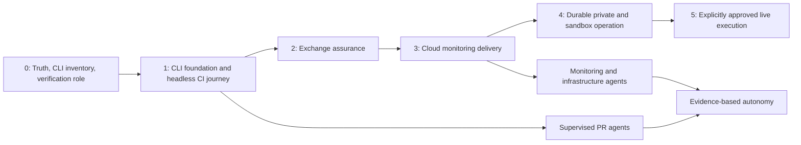

# Roadmap and implementation backlog

[Plan index](README.md)

## Delivery sequence

Advance by demonstrated exit criteria, not dates. A phase may uncover defects that need multiple PRs. Effort should be estimated after the baseline run; time spent diagnosing an unknown exchange or rebuilding an obsolete environment cannot be forecast reliably from source inspection alone.

The CLI is now a first-class workstream from Phase 0. The target is 100% application capability coverage, with agents as the primary automated consumers. UI delivery may follow later. Existing D-series identifiers are preserved; C01–C07 add CLI work and their dependencies below establish ordering. A partial CLI migration is visible as partial until the complete parity gate passes.



Agent development runs alongside delivery maturity. Do not defer the entire agent approach until all SDLC work is finished, and do not make reliable application delivery depend on a custom orchestrator.

### Phase 0 — establish truth and a bounded verification role

Deliver an updated repository map, a complete application capability/CLI-gap inventory, a reproducible toolchain, a baseline report, and the first versioned verification role/task/result contract. Define the CLI/API/output/auth contracts before building feature-specific commands. A manually invoked agent can run the baseline and propose work; a human can run the same commands.

Exit: current commands and service names agree; implemented, mocked, planned, and missing-CLI capabilities are distinguished; every existing check is classified as pass/fail/skip/not-run with evidence; critical missing dependencies are explicit; no live credentials are needed. Known defects become bounded backlog items. This phase does not require that all legacy tests already pass.

### Phase 1 — make a trustworthy change path

Repair builds, implement the CLI foundation and first real headless journey, establish deterministic CI, and introduce protected GitHub work/PR conventions. Deliver read/query/simulation and application-state commands incrementally against the capability inventory. Move the verification role into an isolated manually dispatched workflow. Add implementation/reviewer roles after their patch/evidence flow can be validated. UI work proceeds as a secondary client track.

Exit: a fresh checkout builds the CLI and required service images and passes required checks; missing Redis causes a clear failure; noninteractive auth → query → stream update works through the installed CLI with no frontend; schemas, stderr/stdout, exit codes, and permission denials are tested; test artifacts identify exact revisions. The supported scope has complete CLI coverage and remaining migration gaps are visible. An agent can propose a bounded fix without repository-write or production credentials.

### Phase 2 — qualify exchange integrations

Create the capability registry, fixture replay, structured public probe, and dependency maintenance lane. Qualify one public exchange first, then add others only when their requirements are understood. Begin scheduled public probes and let the integration agent investigate failures.

Exit: selected exchanges pass representative REST/WS assertions from the intended cloud region and their application results are usable through the CLI; three scheduled runs spanning at least 24 hours provide initial stability evidence; recovery/cancellation are tested; unverified exchanges are disabled or clearly marked. These initial runs do not prove long-term reliability.

### Phase 3 — cloud monitoring with repeatable release and recovery

Approve a costed GCP design, provision the monitoring pilot, and deploy from CI using immutable images and versioned CLI artifacts. Add staging, external CLI health/freshness checks, rollback, budget monitoring, and the reliability agent in read-only mode. The pilot must operate without a frontend; expose the UI only when its own checks pass.

Exit: one approved PR is built, staged, promoted, observed, deliberately broken in staging, and rolled back through the documented workflow. The owner can install the CLI and identify production commit/digests, CLI version, and supported capabilities. Current/previous supported client compatibility is tested. A simulated incident produces one useful issue and an urgent notification when appropriate. Host replacement and pilot data recovery are demonstrated. No private trading keys are present.

### Phase 4 — durable private data and sandbox execution

Provision the durable PostgreSQL configuration, secret separation, explicit environment modes, private read testing, and execution fault tests. Separate the execution workload identity/host before granting write keys. Require fail-closed startup and reconciliation behavior.

Exit: restore drill meets approved recovery objectives; private data/credentials are protected; every proposed execution capability has sandbox or explicit alternative qualification; CLI lifecycle commands include preflight, submit, operation status, wait, and supported cancellation; rejected/mismatched approvals block actions; duplicate ownership cannot issue duplicate commands; sandbox cleanup succeeds or reliably quarantines the account. C07 proves complete CLI parity for all implemented capabilities before declaring the CLI migration mature.

### Phase 5 — narrowly approved production execution

Prepare a concrete release-and-execution dossier with CLI reproduction and observation commands. The owner chooses the allowed account/product/instruments, limits, duration, stop conditions, response coverage, and remaining accepted risks. Execute the approved live qualification separately from CI through the CLI/shared backend contract, then decide whether to permit ongoing operation within the same bounded policy. No browser step is required to operate the application.

Exit: the live canary has a complete audit trail, durable/external state reconciles, stop/revoke procedures work, no unexplained open operations remain, and the owner approves the next operating envelope. Normal production changes still pass the SDLC gates. Broader strategy autonomy is a separate program.

### Phase 6 — expand agent authority only where justified

This phase can start for low-risk development tasks before Phase 5. Evaluate agents on real supervised work, add the product/backlog role, and permit selected R0/R1 auto-merge or bounded reliability runbooks. Add the durable dispatcher only when serialized GitHub workflows are demonstrably insufficient.

Exit: each granted authority has a documented evidence threshold, budgets, rollback, revocation test, and an owner. Concurrency/failure tests prove no lost tasks, duplicate PRs, stale approvals, or privileged execution of untrusted content.

## Work packages ready to become GitHub issues

IDs below are planning identifiers, not existing issue numbers. Convert them into issues only when implementation begins. Each row is an outcome; split into smaller PRs if needed. “Depends on” names required predecessors, not merely suggested order. The owner remains accountable even when an agent is the implementer.

| ID | Work and primary role | Depends on | Deliverable and acceptance |
|---|---|---|---|
| D01 | Reconcile repository instructions — verification | None | Current service/package map; correct README/AGENTS commands; configuration inventory; every documented command checked against files |
| C01 | Application capability and CLI contract inventory — verification + implementation | D01 | Complete API/UI/utility/domain capability registry; mocked/planned status; command tree, OpenAPI/event and machine schemas; every missing CLI path tracked |
| D02 | Reproducible toolchain and baseline — verification | D01 | Pinned Go/Node/npm/lint versions; clean bootstrap; baseline JSON/report with all checks and skips; no inherited `.env` or local Redis |
| D03 | First verification role contract — owner + verification | D01 | Versioned role, task/result schemas, allowed commands/tools, budgets and stop rules; manually run on D02 evidence; unknowns remain explicit |
| C02 | Unified Go CLI foundation — implementation | D02, C01 | `gembo` entrypoint/client/rendering; help/schema/capabilities, profiles, headless auth, JSON/NDJSON, errors/exits, cancellation; no frontend/CCXT runtime dependency |
| D04 | Repair application packaging — implementation | D02 | Current backend targets, frontend image, `.dockerignore`, non-root runtime, safe config injection; all images build from clean checkout without secrets |
| D05 | Disposable DB integration harness — verification | D02 | Configurable Redis/Postgres test endpoints, migrations/seed/cleanup, no external DB attachment; required suite fails if dependency missing |
| D06 | Deterministic CI and required checks — implementation | D04, D05 | Go tests/lint/vet/build, CLI conformance/parity check wiring, frontend lint/type/build for affected/shipped UI, stable aggregate check, timeout/cleanup; seeded faults fail correctly |
| D07 | CLI/API/stream contract and E2E journey — implementation + verification | D05, C02 | Real executable auth/query/watch/state change; no frontend; machine schema and exit assertions; reconnect/gap, expired session, wrong-user/denied-execution cases pass |
| C03 | Read, simulation, account, and application-state CLI coverage — implementation | C01, D07 | All implemented query/filter/report/simulation/workspace and credential-management capabilities mapped to commands; mock/private test data; pagination, safe secret input, redaction, and per-capability E2E |
| C05 | CLI release and compatibility pipeline — infrastructure + verification | D04, D06, C02 | Versioned archives/OCI image, checksums/provenance, supported-OS installation tests, API/protocol skew tests, schema/help drift and parity report; agents pin artifact digest |
| D08 | Production configuration/security baseline — implementation + independent review | D02, D07 | Fail-closed secrets; headless identity/role enforcement; authorization for admin actions; rate limits; no secret image layers; targeted negative tests; UI origin/cache gates apply before UI exposure |
| C06 | UI alignment as a secondary client — implementation + verification | D07, C03, D08 | Shared API/domain contracts; browser auth/subscription/cache fixes and exposed-feature E2E; missing UI features explicitly allowed; does not block a CLI-only deployment |
| D09 | GitHub issue/PR and approval conventions — owner + infrastructure | D03, D06 | Templates, minimal labels/Project policy, branch rules, owners and risk classifier; authorized bot PR runs checks and cannot bypass protection |
| D10 | Isolated agent workflow and publisher — infrastructure | D03, D06, D09, C02 | Trusted dispatcher, disposable worker, separate broker/verifier, allowlisted Gembo CLI tool wrapper, schemas/audit/cancellation; malicious issue/patch/CLI argument tests denied |
| D11 | Exchange capability inventory — integration | D02 | All existing adapters classified by product/environment/method; wired vs supported vs verified distinct; official sources/date included |
| D12 | Structured public probe and parser replay — integration + verification | D05, D11 | Extend current probe/factory; JSON/JUnit, required-symbol failures, bounded REST/WS, raw/normalized fixture provenance; no silent skip |
| D13 | Candidate-region public qualification — integration | D06, D12 | One approved egress/location tested, rate budgets enforced, selected exchanges pass and report freshness/reconnect; regional blocks remain explicit |
| D14 | Dependency maintenance lane — integration | D06, D12 | One update bot; dedicated CCXT PR policy; fixtures + live candidate qualification; dependency/security exception process exercised |
| D15 | GCP topology, budget, and recovery ADR — infrastructure + owner | D04, D08, D13 | Pilot/durable bill of materials, resource measurements, region/egress validation, DB choice, RPO/RTO and budget decisions; owner approval before spending |
| D16 | IaC bootstrap and environment isolation — infrastructure | D15 | Versioned state, IAM/federation, networks, artifact registry, secrets, TTL/budget controls; separate staging/prod; denied-access tests |
| D17 | Immutable release and staging promotion — infrastructure | D06, D07, D16, C05 | Manifest, image and CLI digests, controlled migration job, installed-CLI staging smoke/live evidence, approval dossier; no rebuild on promotion |
| D18 | Production monitoring deployment and rollback — infrastructure + owner | D08, D13, D17, C03 | Owner-only headless API/CLI deployment; exposed-port audit; old/new image and supported CLI test; revision discovery; observed rollback/host replacement; UI optional |
| D19 | Telemetry and deterministic alerts — reliability | D18 | Readiness/freshness/heartbeat/resource metrics; external synthetic check; redaction and missing-telemetry test; urgent route chosen |
| D20 | Monitoring-to-issue agent — reliability | D10, D19 | Read-only evidence queries, fingerprints, bounded issue creation, incident lifecycle, quiet unchanged state; duplicate-alert and model-outage tests |
| D21 | Durable PostgreSQL and restore rehearsal — infrastructure | D16, D17 | Managed DB/backups/PITR, encryption-key retention, isolated restore, schema/application compatibility; measured recovery objectives before live data |
| D22 | Explicit exchange environment and private-read harness — integration | D08, D11, D21, C03 | Production/testnet/demo validation, environment-specific keys, endpoint allowlist; private CLI auth/query/stream and empty-account assertions; no fallback to prod |
| D23 | Execution delivery and failure semantics — implementation + verification | D05, D22 | Durable intent/idempotency audit, fenced ownership, ambiguous-request reconciliation, restart/lost-event tests; reconciliation failure blocks new action |
| C04 | Complete mutation and operation lifecycle CLI — implementation + verification | C03, D23 | Position/admin/execution command families; preflight, idempotency, operation get/wait/cancel, uncertainty and permission semantics; real subprocess E2E with deterministic adapters |
| D24 | Sandbox execution qualification — integration + verification | D12, D22, D23, C04 | Per-capability CLI create/query/cancel/recovery cases, unique test IDs, bounded operations, verified cleanup/quarantine; differences from production recorded |
| D25 | Production execution authorization and revocation — owner + infrastructure | D10, D18, D19, D21, D23, D24 | Isolated workload, narrow keys, signed/authenticated approval record, matching digest/config, expiry/revoke controls; all negative tests pass |
| C07 | Full CLI parity and agent workflow acceptance — verification + owner | C03, C04, C05, D25 | 100% of implemented capabilities have supported commands and passing scenarios; planned/mock gaps remain explicit; authorized agent completes headless workflow and handles denied/uncertain outcomes; UI parity not required |
| D26 | Supervised live canary — owner + release | D25, C07 | Concrete owner-approved execution dossier with CLI commands; independent observation, reconcile/stop/cleanup evidence, explicit decision on next scope |
| D27 | Agent evaluation and authority promotion — verification + owner | D10; D20 for ops authority | Held-out tasks, injection/refusal/timeout/cost evaluation, supervised sample results, explicit per-action allowlist and rollback |
| D28 | Product/backlog review role — product + owner | D19, D27 | Periodic scope/state review with evidence, value, effort, dependencies; proposals remain Inbox until prioritized; no trading authority |
| D29 | Durable dispatcher and concurrent agents — infrastructure | D10, D27; observed need | Transactional ledger/leases, idempotent delivery/publishing, recovery, cancellation, DLQ, rate limits; crash/duplicate/stale-worker tests |
| D30 | Recurring platform maintenance — infrastructure + reliability | D18, D19; D21 for durable data | Patch/rotation/restore/drift/cost calendar with runbooks and owners; failed maintenance becomes actionable work |

D08 should be split into focused PRs; the work package is a cloud-exposure gate, not a request to combine all security changes in one diff. D23 is an audit-and-qualification outcome: preserve functioning reconciliation and introduce a new queue/outbox only where tests establish a need.

C03/C04 are capability-group milestones, not giant PRs: split by resource/workflow and add backend operations where the current API is insufficient. Test unapproved capabilities with fake/sandbox adapters; full command coverage never authorizes live execution. C07 closes the initial full-parity migration, while CI enforces complete CLI coverage for every new supported feature throughout. C06 is required before exposing affected UI surfaces, independently of a CLI-only cloud release.

D13 may use an existing permitted regional runner or a separately approved, low-cost disposable GCP preflight. Prepare its tiny time-limited cost/cleanup proposal before launching it; this does not authorize the permanent D16 deployment. The resulting reachability and resource measurements inform D15, avoiding a circular requirement to choose a region before testing it.

## First four increments

**Increment 1: baseline, capability inventory, and verification role.** D01–D03 and C01. Produce one trustworthy report, a complete CLI-gap inventory, and a reusable agent contract. No cloud purchase and no live exchange keys. The report can be red; its completeness is the acceptance condition.

**Increment 2: CLI foundation and reproducible vertical slice.** C02 and D04–D07. Repair packaging, provision disposable stores, add CI, and prove headless CLI auth → data → stream update without Next.js. Begin C03 and C05 as the foundation stabilizes. Keep commands, packaging, CI, and stream behavior in focused PRs.

**Increment 3: bounded agent PR loop, CLI coverage, and external confidence.** D09–D14, C03/C05, and cloud-facing D08. Demonstrate one real issue handled by an isolated implementer and independently verified. Qualify one public exchange and expose its results through the CLI. C06 repairs the UI on its own track.

**Increment 4: costed cloud pilot.** D15–D20. Provision after reviewing costs and region access; install the CLI and deploy/rollback/observe public monitoring through it. Expand private/sandbox/live scope through D21–D26 and C04/C07 afterward.

Do not activate all agent roles in Increment 1. Do not bring every exchange online at once. Both make failures harder to attribute and increase the amount of unverified operating behavior.

## Proposed artifact layout

These are implementation destinations, not files already created by this plan:

```text
.github/
  ISSUE_TEMPLATE/             outcome, incident, dependency, proposal forms
  workflows/                  CI, probes, release/deploy, bounded agent tasks
  CODEOWNERS                  explicit sensitive-area ownership
docs/
  delivery/                   this plan, updated as decisions change
  architecture/decisions/     cloud, auth, environment, data, authority ADRs
  runbooks/                   deploy, rollback, recovery, credentials, incidents
  reports/baseline/           sanitized baseline and test inventory
  cli/                        command reference, schemas, examples, compatibility
backend/
  cmd/gembo/                  unified product CLI entrypoint
  internal/cli/               commands, typed transport client, output formatting
agents/
  roles/                      verification, implementation, reviewer, etc.
  policies/                   trust, risk, scope, budgets, approval rules
  schemas/                    task/result/approval/release schema definitions
  evals/                      task fixtures, failure and refusal scenarios
infra/
  bootstrap/                  minimal account/state/federation setup
  modules/                    shared infrastructure definitions
  environments/               separate staging/production state/configuration
deploy/
  compose/                    dev/test/pilot definitions and safe defaults
  manifests/                  schema/templates; live private records elsewhere
tests/
  contracts/                  application capability registry; HTTP/WS/CLI schemas
  cli/                        subprocess, non-TTY, install, and version-skew tests
  exchanges/                  capability registry and sanitized fixtures
  e2e/                        primary CLI/system journeys; exposed-feature UI tests
scripts/
  verify/                     shared, documented validation entry points
  release/                    trusted release/manifest/rollback tooling
```

Reuse current directories where that avoids unnecessary moves. For example, extend the existing `backend/cmd/exchange-probe` and retain Go package-local tests. Do not relocate application code merely to match this suggested tree. Public repository files hold safe configuration/templates; credentials, private reports, live approval records, and Terraform state belong in restricted storage.

## First implementation brief

Assign this bounded brief to the first verification/engineering session:

> Establish Gembo's reproducible development baseline at the selected commit under its CLI-first, agents-first requirement. Read the delivery plan and reconcile it with the current tree. Update stale commands and document current processes, stores, and test entry points. Inventory every API/UI/utility/domain capability, separating implemented, unverified, mocked, and planned behavior; map each to a proposed CLI command and explicit coverage gap. Prepare the CLI/API/machine-contract design and a pinned, credential-free development environment. Execute existing build/test/lint checks where possible, recording failures and skips honestly. Define the first verification role and structured result contract. Preserve application behavior; propose focused packaging, CLI foundation, streaming, configuration, and integration issues. The next vertical slice must work through an installed CLI without Next.js or browser interaction. Produce a baseline report and focused PRs with clear acceptance evidence. Do not provision cloud resources, access live accounts, enable execution, or create scheduled autonomous work as part of this initial brief.

Required first handoff: exact commit and environment, reproducible commands, result artifacts, changes made, remaining failures, evidence-backed next issues, and a recommendation for the next smallest increment.

## Phase review checklist

At every phase boundary, verify these questions with evidence:

1. Can another person or fresh agent reproduce the result from the repository and linked artifacts?
2. Are observations distinguished from assumptions and unsupported capabilities?
3. Did tests execute the actual boundary being claimed, with required skips treated correctly?
4. Can the previous accepted release or operating mode be restored without losing essential state?
5. Are credentials, private evidence, and operating permissions isolated from implementation agents?
6. Does a stopped, duplicated, or malicious agent leave the system in a known state?
7. Are resource costs, cleanup, and an accountable owner defined?
8. Is the next step a concrete work item with dependencies and acceptance criteria?
9. Does each supported application feature have complete, tested noninteractive CLI coverage, with overall migration gaps and UI status reported honestly?

## Open-decision register

| ID | Decision owner | Evidence to prepare | Gate |
|---|---|---|---|
| ADR-01 | Owner + infrastructure | GCP account/project arrangement, candidate region, measured exchange reachability, monthly cost ceiling | D15/D16 |
| ADR-02 | Owner + infrastructure | Cloud SQL vs paid Supabase recovery/cost comparison; pilot data disposal or migration procedure | D15/D21 |
| ADR-03 | Owner + implementation | Shared HTTP/stream contract; headless CLI and agent authentication; separate browser auth/cache/session behavior | C01/C02/D07/D08/C06 |
| ADR-04 | Owner + integration | Initial exchange/product/instrument scope; sandbox support and regional constraints | D11/D13/D22 |
| ADR-05 | Owner + reliability | Notification route, available response coverage, SLO/RPO/RTO and escalation | D19/D25 |
| ADR-06 | Owner + agent infrastructure | Runtime/model budget, repository App permissions, approval semantics, public/private evidence boundary | D10 |
| ADR-07 | Owner + release | Concrete production execution envelope and residual differences from sandbox | D25/D26 |
| ADR-08 | Owner + verification | Eligible automation classes, evaluation thresholds, concurrency and remediation authority | D27/D29 |
| ADR-09 | Implementation + verification | CLI capability inventory, machine protocol/exit codes, version/deprecation window, platform artifacts and compatibility policy | C01/C02/C05/C07 |

If an owner decision is not available, complete independent preparatory work and leave the dependent gate closed. Do not manufacture consent from an elapsed timeout or a green test result.

## Avoiding predictable dead ends

| Temptation | Why it creates rework | Intended alternative |
|---|---|---|
| Upgrade all dependencies immediately | Cannot distinguish old defects from upgrade regressions | Baseline first, isolated upgrade PRs |
| Make all live calls mandatory on every PR | External outages/geography create noise and secrets risk | Deterministic PR gates plus classified live qualification |
| Use an LLM's review as the release gate | Plausible claims do not prove execution | Independent checks, immutable evidence, bounded approvals |
| Start with several agents editing one checkout | File and process interference obscures ownership | One run/checkout; controlled concurrency later |
| Give the “infra agent” cloud administrator access | Planning and application become indistinguishable | Read/plan role and separate protected apply workflow |
| Use free services as an availability guarantee | Quotas, suspension, and backups may not meet live needs | Disposable pilot; paid durable mode when requirements demand it |
| Treat a Project column as a lock | Events and field updates can race | Dispatcher ownership and later transactional leases |
| Treat a successful deployment as permission to trade | Software state and operating authority differ | Separate execution authorization record and runtime enforcement |
| Resolve incidents when a PR merges | The service might still be degraded | Verify deployed recovery before resolution |
| Store the whole operating system in prompts | Prompts drift and are not enforced permissions | Shared code, schemas, policies, tests, and runbooks |
| Build a UI feature and promise a CLI later | Creates application features that agents cannot reliably use | Require CLI command/contracts/E2E before feature completion; UI may follow |
| Wrap arbitrary HTTP calls or browser clicks and call it CLI parity | Omits discoverable workflows, lifecycle semantics, and stable machine contracts | Supported commands for all capability options/results and full agent journeys |
| Duplicate business rules in CLI and UI | Produces divergent validation and results | Shared backend application services and compatibility tests |
