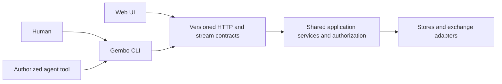

# CLI-first application contract

[Plan index](README.md)

This is a required product and delivery constraint: **Gembo's CLI covers 100% of application capabilities and is designed for agents first, while remaining usable by humans.** The web UI is another client of the same application and may deliver a smaller subset. CLI capability coverage and permission to exercise a capability are separate: providing an execution command does not grant an agent trading authority.

All command names, formats, and paths below are proposed contracts to implement and validate. A unified `gembo` CLI does not yet exist in the inspected tree.

## Define and enforce full coverage

Create a versioned application capability registry, distinct from the exchange-method registry. Inventory API routes, UI actions and derived domain information, saved application state, existing utilities, background-service outcomes, administrative workflows, and planned features. Counting HTTP routes alone misses UI-only calculations and end-to-end workflows.

Each capability record contains a stable ID, description, implementation status, authoritative service/API operation, CLI command and input/output schemas, permission/risk class, environment support, tests, owner, and UI status. Use explicit statuses such as implemented, unverified, mocked, planned, and retired. Record missing CLI coverage as a gap; do not hide it by relabelling an implemented feature “unsupported.”

Full CLI parity means every implemented application capability is discoverable and usable through a supported CLI workflow, including all meaningful options, results, error handling, and asynchronous completion. A generic HTTP escape hatch, raw database access, or undocumented shell script does not satisfy parity. Required cases include both allowed and denied operations. Purely visual preferences such as animation and layout need not be reproduced, but underlying data, business calculations, filters, saved workspaces, and actions must be available.

The registry records mocked/planned functionality without treating it as working. The transfers page's mock history/fees and dashboard's mock statistics need real domain/API implementations before being claimed as real CLI features. Keep them visible as product gaps; a CLI command returning fabricated production data is not parity. Any future real transfer capability must ship in the CLI first and receive its own operating approval.

Incremental CLI releases may initially cover a declared subset, with the total gap visible. The first migration is complete only when all implemented capabilities have coverage; subsequent features cannot be declared done or shipped as supported without it. Require **100% coverage of the supported release manifest**, plus a report against the entire application inventory. Changing the supported set requires explicit review, and is not a way to conceal missing migration work. UI absence does not block a CLI-complete feature. Broken behavior in a UI surface that remains deployed still needs a fix or explicit disablement.

## One application, multiple clients

Implement the CLI as a Go binary at proposed `backend/cmd/gembo`, with command handlers separated from the transport client and output rendering. Use Cobra for the command tree, help, and completion, pinned as a normal reviewed dependency. Keep the application HTTP client lightweight: ordinary commands should not link CCXT, connect directly to Redis/Postgres, require a checkout, or start the backend. Follow the existing Go conventions. [Cobra documentation](https://cobra.dev/docs/).

Business decisions, authoritative calculations, validation, tenant authorization, approval enforcement, and idempotency belong in shared backend services. The CLI may validate input early and format results, but the server must repeat consequential checks. Move domain calculations that exist only in React behind shared application contracts where they must agree across clients. Do not make the UI shell out to the CLI or maintain a second execution engine inside it.

Define HTTP operations in a versioned OpenAPI document and event/CLI envelopes in JSON Schema. Choose and pin schema dialects/tool versions that the selected validators support. Contract checks reconcile declared operations with handlers and client behavior; documentation generation alone is not proof of compatibility. [OpenAPI specification](https://spec.openapis.org/oas/latest.html), [JSON Schema reference](https://json-schema.org/understanding-json-schema/reference).

Treat `exchange-probe`, `create-user`, and `ccxt-raw-positions` as existing specialist utilities to assess and reuse. Normal product operations go through the service API. A privileged bootstrap/diagnostic command can invoke a controlled administrative workflow or separately packaged tool with explicit capability checks; keep its database/exchange credentials out of the ordinary client. Sensitive raw payload dumping is not a default agent interface.

## Command surface

Use resource nouns with explicit verbs. The inventory determines final names and options; this table establishes required families, not an assertion that corresponding APIs all exist today.

| Family | Required capabilities |
|---|---|
| `gembo version`, `help`, `schema`, `capabilities` | Client/server versions; local command discovery; schemas/examples; server feature, permission, environment, and compatibility discovery |
| `gembo config`, `auth` | Profiles/endpoints; inspect effective non-secret settings; headless login/token use; identity/scope/status; logout/revocation |
| `gembo exchanges`, `markets`, `tickers`, `funding-rates` | List/get/filter/paginate; supported streaming; freshness/provenance and capability status |
| `gembo arbitrage funding`, `arbitrage spread` | Query opportunities, simulate, inspect inputs/results, subscribe to updates |
| `gembo account`, `balances`, `credentials` | Account information; balances; credential create/update/delete and redacted metadata; permission/environment checks |
| `gembo workspaces` | List/get/create/update/delete/import/export of saved application state; conflict detection |
| `gembo positions` | Preflight/create/list/get/close/size/margin/delete where supported; orders and funding history; explicit permission and execution-mode checks |
| `gembo operations` | Get/list/wait/cancel where cancellation is supported; status of accepted asynchronous requests; reconciliation of uncertain outcomes |
| `gembo status`, `diagnostics` | Service/data health, release identity, bounded redacted diagnostics, approved probe workflows |
| `gembo admin` | Authorized user bootstrap/administration and permitted maintenance through a separately privileged API/workflow; destructive functions explicitly restricted |
| `gembo execution` | Inspect authority, request approval, grant/revoke via authorized identity, and apply defined stop controls; no client-side bypass |
| Future reports/transfers/etc. | Every newly implemented application capability appears in CLI with the same feature/permission gates before or alongside any UI |

Platform operations such as Terraform apply, GitHub review, cloud restore, and agent dispatch remain reproducible through trusted scripts and official CLIs (`gh`, `gcloud`, Terraform). Document them as headless runbooks with structured inputs/results. They do not all need to be reimplemented inside `gembo`. No application workflow may require browser automation; a platform approval must still authenticate the approving human and cannot be manufactured by passing a CLI flag.

## Noninteractive and human behavior

Every application workflow must run without a browser, TTY, pager, editor, clipboard, terminal colors, or interactive wizard. Provide `--no-input`; it must fail promptly with a structured missing-input error instead of prompting. Infer noninteractive behavior when stdin is not a terminal, and let agents request it explicitly. Do not read stdin implicitly when it might block; require `--input -` or a named credential input option.

Support `--output json` for one-shot machine results, `--output ndjson` for streams, and `--output table`/`text` for humans. Default to human output on a TTY and JSON off-TTY; agents always specify the format. Keep stdout reserved for the selected data format. Prompts, diagnostics, progress, and deprecation notices go to stderr, without secret values. Machine modes never emit banners, ANSI codes, or prose outside their schema.

Provide explicit flags for common arguments and `--input <file>`/`--input -` for versioned structured requests. Reject unknown fields/flags and ambiguous mixed input instead of silently ignoring them. Document whether a flag may override an input field; default to rejecting conflicting values. Preserve financial amounts as decimal strings and timestamps as UTC RFC 3339 values. Supply explicit pagination/cursor, filtering, sorting, time-range, and result-size limits; make `--all` deliberate and bounded by timeout/max-items.

Human ergonomics include concise help with examples, safe shell completion, readable columns, explicit units, and actionable error messages. Completion must not unexpectedly query private services or mutate state. Optional interactive prompts are conveniences over the same command path; they never provide an exclusive feature. No TUI is required for the initial CLI.

## Output and error protocol

Version the machine protocol independently of the CLI executable. A one-shot response has `schema_version`, `data`, `error`, and `meta`. `meta` includes client/server version when known, request/operation ID, effective profile/environment, timestamps, pagination, completeness, and freshness where relevant. `error` is null on success; otherwise it contains a stable code, message, structured details, retryability, and outcome certainty. Do not expose backend internals or credentials.

In JSON mode emit one valid JSON envelope on both ordinary success and command failure. A terminated process may not produce a final envelope, so callers must also check exit status and output validity. Failed validation must not emit a successful-looking partial result. For batch queries, expose per-item status and overall `complete`/`partial` state; a requested complete result with failures returns nonzero.

Proposed stable exit contract:

| Exit | Meaning |
|---|---|
| 0 | The requested command contract succeeded; `submit` means accepted, `--wait` means terminal success |
| 1 | Internal/unclassified failure; never the only available machine error classification |
| 2 | Invalid command, input, configuration, or output-format usage |
| 3 | Authentication missing/expired/invalid |
| 4 | Authorization denied or required approval absent/expired |
| 5 | Requested resource not found |
| 6 | Conflict, failed precondition, or rejected domain operation |
| 7 | Rate limit or transient service/transport failure with a known outcome |
| 8 | Deadline exceeded or outcome uncertain; inspect the machine error before deciding what to do |
| 9 | Required capability/protocol unsupported or client/server incompatible |
| 10 | Partial result where completeness was required |
| 130 | User interruption on platforms that support this convention; remote operation may continue |

This mapping is a Gembo design proposal, not a claim of a universal exit-code standard. Document OS signal differences. Agents branch on stable error code plus outcome certainty, not English messages or exit number alone. Do not map HTTP success directly to completed business success.

Provide local `gembo schema <command> --output json` and machine-readable command enumeration without contacting the backend. `gembo capabilities` also reports actual server/environment support and current principal permissions. Advertised support never means that the current caller is allowed to execute it.

## Streaming and asynchronous operations

Streaming commands emit bounded-size NDJSON records with schema version, event type, subscription/correlation ID, timestamp, and payload. Distinguish snapshots, updates, reconnect/gap notices, heartbeat, error, and terminal status. Flush records promptly; do not retain an unlimited stream in memory. Support duration/count bounds and cancellation so agent tasks finish predictably.

The current Pub/Sub path cannot be assumed to replay missed events. On reconnect, resubscribe and fetch a fresh snapshot; emit a gap notice. Support a resume cursor only when the backend has a real durable replay contract. Do not promise lossless watch output from a reconnect loop. Bound buffers and define overflow behavior; report loss or terminate instead of silently dropping required data.

For asynchronous mutations return a durable operation ID and state such as accepted/running/succeeded/failed/needs_reconciliation. Provide `operations get/wait` and a command-level `--wait --timeout`. A disconnected client or expired wait does not cancel a remote operation. Cancellation is an explicit authorized request with its own result and supported-state rules.

Mutations take a client-supplied idempotency key, scoped by principal, environment, operation, and canonical request hash. Reuse with a different request is rejected. Persist a received/generated key before sending if the client manages one; agents supply their task-derived key explicitly. On ambiguous timeout, query operation/idempotency status and reconcile before retrying. Specify deduplication retention and refuse unsafe retries after it expires. Do not claim exactly-once exchange effects from API idempotency alone.

`--dry-run` or `preflight` performs validation/planning without side effects and clearly states what cannot be known until execution. For high-impact actions, return an expiring plan ID/hash bound to target, inputs, principal, revision/config, and approval scope; execution rechecks preconditions. A human confirmation such as `--yes` suppresses a local prompt only. It cannot confer server-side permission, override a denied capability, or replace execution approval.

## Authentication, profiles, and authority

Separate human sessions and agent service identities. Agents use short-lived scoped tokens supplied through a credential broker or protected input, restricted by role, account, environment, and action. Human login must have a terminal-only path; a browser-based flow may be an optional convenience. Administrative enrollment, session expiry, refresh, rotation, and revocation need explicit APIs/workflows rather than reliance on browser localStorage. These are capabilities to add, not existing guarantees.

Never pass passwords, tokens, or exchange secrets in command arguments or ordinary JSON output. Offer protected file descriptors/stdin/files for secret input, a separate token source from request-body stdin, and OS credential storage for humans where supported. Agents should not receive production exchange secrets; the backend stores and uses them. Credential list/get returns metadata and redacted values. Define behavior when secure storage is unavailable; do not silently fall back to plaintext persistence. Synthetic tests verify logging, crash, and error redaction.

Profile configuration stores endpoint/environment and non-secret settings. Define precedence: explicit flags, explicit `GEMBO_*` environment settings, selected user profile, then safe defaults. Agent runs use an isolated config directory and explicit endpoint/profile; do not read an arbitrary repository's config or `.env`. Local config file writes are atomic and concurrency-safe.

Remote connections require TLS validation. Bind credentials to their intended endpoint/audience; refuse forwarding auth across origins or arbitrary redirects. Production writes require an explicit production target and valid server-side authority. `--profile production` only selects a destination. A global `--unsafe` bypass must not exist. Audit principal, task/run ID, CLI version, request/operation ID, and approval reference on the server.

## Packaging and compatibility

Release the CLI as a first-class artifact alongside backend images. Initial required targets: Linux amd64/arm64 for automation and macOS arm64/amd64 for humans; track Windows support explicitly and add a tested native artifact before claiming it. A minimal OCI CLI image supports pinned agent runs. Installation does not require Go, Node, CCXT, a source checkout, or the web application.

Publish checksums and verifiable provenance/signature information, versioned archives, release notes, and reproducible installation examples. Test install/uninstall and a clean-home smoke on supported targets. Use release archives and the OCI image first; add package-manager channels later using the same artifacts. Do not auto-update an agent's executable during a task; pin version/digest and report it in evidence.

Record CLI artifact digests and supported API/protocol ranges in release manifests. Test candidate CLI against current and previous supported server releases, and previous supported CLI against the candidate server. Choose and publish the initial support window; proposed default is current and previous minor API/CLI series where compatible. Breaking command/flag/schema/error changes require explicit versioning, migration notes, and deprecation policy. New enum values and reordered/default-changed results need compatibility consideration too.

Server rollback and CLI rollback are separate actions because clients may already be installed. Refuse incompatible dangerous operations before sending them. Capability discovery should explain missing newer functionality without making unrelated older commands unusable. Agent prompts/examples/schemas must be pinned to the CLI version they describe.

## Acceptance and agent integration

Run the built executable as a subprocess in tests, capture stdout/stderr/exit separately, validate schemas, and assert backend effects. Test with no TTY, no browser, empty HOME-equivalent config directory, stdin closed, redirected output, timeouts, malformed input, expired/revoked auth, permission denial, pagination, Unicode/symbol encoding, SIGINT, broken pipes, partial results, WS reconnects, and incompatible server versions. Shell quoting and process-list/log secret exposure need explicit checks.

The primary E2E journey is **CLI → authenticated API → real services/stores → CLI result/stream**, using deterministic exchange fixtures. Add all mutation/lifecycle workflows through fake/sandbox adapters and negative approval tests. Browser checks verify only features exposed by the UI. A feature missing from UI is an allowed lag; a CLI-only feature missing tests is a release gap.

A machine-readable parity report maps each capability to a passing scenario against the release candidate. Required CI checks prevent unmapped new API operations/features and detect drift in CLI schemas/help/examples. Review semantic coverage: a command that ignores half the API options does not count as complete.

Agents invoke an allowlisted command with an argument array and structured input; they do not assemble shell strings from issue/log content. A deterministic tool wrapper enforces command family, flags, profile, request size, deadline, output size, and credentials before launching the CLI. It parses schema and status, treats returned strings as untrusted data, and retains sanitized evidence. CLI availability does not expand a role's permissions. Browser automation is reserved for UI verification, not routine application operation.

If MCP or another tool interface becomes useful later, wrap the same command/client contract and policy. Do not build another backend integration or business-logic path. Test the actual agent workflow: discover a schema, read data, submit an allowed sandbox operation, wait for completion, handle a denial/uncertain result, and exit within budget without manual UI intervention.
