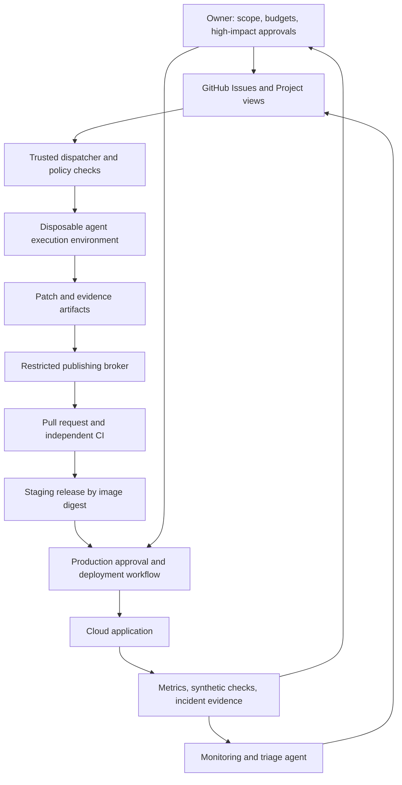

# Gembo delivery and agent operating plan

Planning baseline: **28 October 2026**. Repository inspected at `1188c918ecd8d9373c7a713ef8fad62c7f0b78ff`.

Status: proposed implementation plan. This document does not provision infrastructure, activate agents, authorize expenditure, or enable exchange execution. Recommendations and acceptance criteria below are design decisions to implement, not claims about capabilities already present.

D01 repository-instruction reconciliation is implemented locally; see the [handoff and validation limits](../reports/d01-repository-instructions.md). This does not establish the D02 execution baseline or complete Phase 0.

D02 toolchain and isolated baseline artifacts were published in [PR #1](https://github.com/zeroclap/gembo/pull/1), merged at `158eeaaa27eea6858e0e0bf081cd5c30d4d2b2b0`. The [D02 review packet](../reports/d02-reproducible-baseline.md) preserves the reviewed artifact state; the [reproduction guide](../verification.md) describes the baseline. Reported failures/skips remain evidence gaps, and Phase 0 acceptance is still pending.

D03's manual verification role, task/result contracts and evidence rehearsal are prepared for owner review; see the [D03 review packet](../reports/d03-verification-contract.md) and [manual runbook](../../agents/README.md). Independent predecessor review and the C01 inventory remain open; no hosted agent or Phase 0 acceptance is claimed.

## Direction

Build a dependable software delivery system, then delegate increasing portions of it to bounded agents. Every agent should produce work that a person can inspect and that ordinary automation can verify. GitHub Issues describes the work; pull requests describe the changes; executable checks establish correctness; release records establish what is running.

**CLI first, agents first:** a mature `gembo` command-line client must cover 100% of application capabilities. Humans use the same CLI with readable output and optional conveniences. The UI remains important as a human-facing client and may lag in feature coverage. Shared backend contracts and authorization serve both interfaces. A feature is not complete without its CLI command, machine contract, documentation, and acceptance evidence; [the CLI contract](06-cli-contract.md) defines how coverage is measured.

The first useful agent is a **verification agent**. Give it a known checkout, reproducible environment, test commands, a capability inventory, and a structured evidence format. Its initial job is to establish what works, reproduce failures, and propose focused improvements. As the test system matures, the same agent becomes the recurring integration and release investigator. This makes the first investment part of the eventual operating model.

Use **GCP as the preferred cloud**, while allowing free services for disposable development and an early monitoring pilot. Trading execution enters through its own readiness and approval gates. Deployment approval must never implicitly authorize trading.

This plan concerns software delivery and operation. Strategy selection, investment decisions, and performance optimization are separate product work. Account and execution data appear here only where needed to test integration correctness, reconcile operations, detect failures, and enforce operating permissions.

## Read and implement this plan

| Document | Purpose |
|---|---|
| [Repository baseline](01-repository-baseline.md) | Verified starting point, existing assets, concrete discrepancies, and limits of this assessment |
| [CLI-first application contract](06-cli-contract.md) | Full feature coverage, command/API architecture, agent protocol, auth, streaming, compatibility, distribution, and CLI acceptance gates |
| [Quality and exchange assurance](02-quality-and-exchanges.md) | Test layers, live API validation, sandbox boundaries, dependency drift, and release evidence |
| [Cloud and release operations](03-cloud-and-release.md) | GCP topology, inexpensive pilot, environments, CI/CD, secrets, migrations, rollback, and recovery |
| [Agents and GitHub coordination](04-agents-and-github.md) | Agent responsibilities, isolation, permissions, orchestration, approvals, evaluation, and monitoring |
| [Roadmap and implementation backlog](05-roadmap-and-backlog.md) | Ordered work packages, dependencies, deliverables, acceptance gates, and first implementation brief |

The documents form one plan. An agent implementing a work package must read its dependencies and the shared policies, not just its own role description. Proposed paths and command names are marked as future artifacts; they are not existing interfaces.

## Decisions that can be made now

| Decision | Recommended default | Reason |
|---|---|---|
| Work tracking | GitHub Issues and PRs; add a Project as a view | Keeps work and code together without making the board the execution database |
| Primary application interface | Unified Go `gembo` CLI with complete capability coverage; UI may be a subset | Reliable headless operation for agents and humans |
| Application contract | Shared versioned backend API/events; explicit CLI schemas and exit behavior | Prevents separate UI/CLI business logic and browser-dependent workflows |
| Delivery | GitHub Actions, immutable OCI images and versioned CLI binaries, promotion by digest | Usable by humans and agents; preserves evidence across environments |
| Application hosting | A small GCP Compute Engine deployment first; managed PostgreSQL before live execution | Fits continuous collectors without introducing a cluster platform |
| Development database | Local PostgreSQL; optional Supabase Free for a disposable cloud pilot | Retains the PostgreSQL interface and existing migrations |
| Durable production database | Cloud SQL PostgreSQL with explicitly configured backup/PITR policy | Preferred GCP path; paid Supabase is a documented alternative after equivalent recovery tests |
| Redis | Dedicated, private Redis per environment; initially containerized | Existing application uses Redis commands and Pub/Sub; do not assume an HTTP-only cache is compatible |
| Infrastructure definition | Terraform with separate state per environment | Repeatable provisioning, reviewable plans, recoverable infrastructure |
| Test execution | Go and CLI contract tests, real Redis/Postgres integration, CLI E2E, targeted Playwright, bounded exchange probes | CLI journeys are the primary acceptance path; browser tests cover exposed UI features |
| First agent runtime | A trusted GitHub Actions workflow using the Codex GitHub Action | Bounded runs and existing GitHub audit trail; no custom orchestrator required initially |
| Later orchestration | Small deterministic controller only when concurrency/durability requires it | Avoids building an agent platform before establishing useful work |
| Agent identity | Separate roles and least-privilege credentials; dedicated publishing broker | Prevents one coding session from also approving or deploying its own output |
| Autonomy | Advance by action class and measured performance | A successful documentation agent does not establish deployment or incident-response competence |

The Codex Action is a documented CI integration; pin the action and CLI version during implementation and test its sandbox configuration. The runtime is replaceable behind a task/evidence contract. [Official OpenAI documentation](https://learn.chatgpt.com/docs/github-action).

## Architecture of the operating model

The dispatcher, permission checks, release gates, credential handling, and deployment actions are conventional code. Agents interpret evidence and propose changes inside that system. A model response is never the sole proof that a test passed or an action was authorized.

There are two independent progressions:

| Application operating mode | Agent authority |
|---|---|
| Local deterministic tests | Read and report |
| Cloud public monitoring | Propose issues and patches |
| Private account reads | Create PRs under bounded policy |
| Exchange sandbox execution | Eligible changes may merge automatically later |
| Approved production execution | Specific operational actions may become automatic later |

Progress in one column does not automatically advance the other. It is reasonable to run a supervised live application while keeping engineering agents limited to PRs.

## What should remain reusable

Keep these contracts stable while tools evolve:

1. A documented command to reproduce each test tier locally and in CI.
2. Exchange capability records, sanitized fixtures, and semantic assertions independent of the agent model.
3. OCI images and environment configuration that do not depend on an agent session.
4. A release manifest linking commit, image digest, schema compatibility, configuration version, and evidence.
5. A task envelope and result schema shared by manual, scheduled, and event-driven runs.
6. Runbooks expressed as bounded operations with preconditions, postconditions, and rollback.
7. GitHub issue acceptance criteria that can be checked without trusting the implementer.
8. A permission model enforced outside prompts.
9. A complete application capability registry and versioned CLI protocol, including noninteractive auth, errors, streaming, and asynchronous operations.

Do not start with Kubernetes, a multi-agent conversation bus, a custom dashboard, a vector memory system, or a permanently running agent for each role. Add infrastructure only when an observed constraint justifies it. Logical specialization can initially be different role profiles using one execution harness.

Some later work is unavoidable: moving a database, strengthening isolation, or changing a runtime requires validation. The goal is to preserve tests, interfaces, artifacts, and policy, rather than promise that no component will ever change.

## Decisions intentionally left to evidence or the owner

These are tracked implementation checkpoints, not gaps for agents to silently fill.

| Decision | Default until resolved | Latest resolution point |
|---|---|---|
| Monthly infrastructure and agent budgets | No new paid resource provisioned without a costed proposal | Before cloud provisioning or paid scheduled agent runs |
| GCP region and exchange reachability | One candidate European region; verify permitted access from actual egress | Before choosing the pilot region |
| Initial exchanges and instruments | One qualified public integration first; small representative symbol set | Exchange assurance phase |
| Database provider for durable production | Cloud SQL preferred; compare paid Supabase total cost and recovery requirements | Before storing live credentials or execution state |
| Domain and user access model | Owner-only pilot; authenticated application | Before internet exposure |
| Incident notification destination and response coverage | GitHub work records plus an explicit urgent notification route | Before unattended cloud operation |
| Acceptable downtime and recovery objectives | Proposed targets in the cloud plan; no implied availability guarantee | Before production acceptance |
| Production execution envelope | Disabled; no live keys in development or agents | Before live execution qualification |
| Automatic merge/deploy classes | None initially | After measured supervised runs |
| Private operational record location | Restricted cloud storage; public issues contain sanitized summaries | Before ingesting private account/incident evidence |

An agent may prepare an architecture decision record (ADR), comparison, test result, or cost estimate for any unresolved decision. It must not silently turn a proposal into new spending, public exposure, or execution authority.

## Definition of completion

A change is complete when it meets its issue criteria, required checks pass on the final revision, independent review is recorded, deployment and rollback implications are documented, and any required production observation succeeds. Application features additionally require complete CLI coverage and tested noninteractive operation. UI feature availability may follow later; behavior that remains exposed in the UI must still be correct. Merging a PR alone does not mean a production incident is resolved.

The program is ready for broader autonomy when it can repeatedly take a qualified issue through an isolated implementation, reliable validation, approved promotion, and observed operation with a complete audit trail—and can stop safely when evidence or permissions are insufficient.
